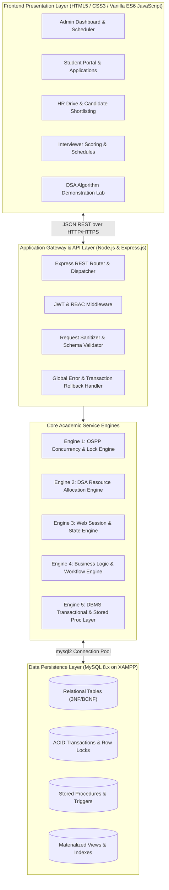
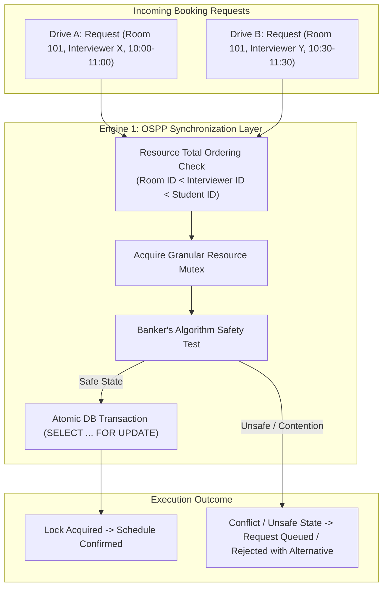
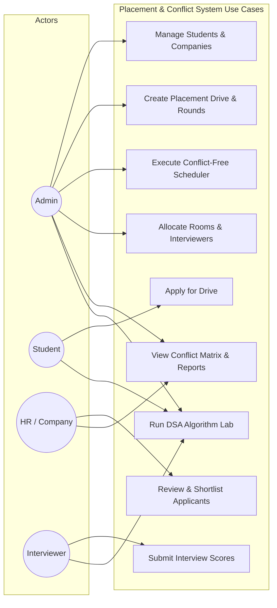
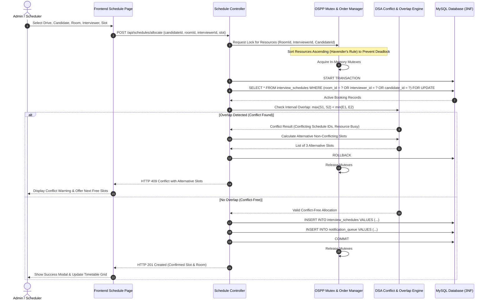

# System Architecture & Technical Blueprint
## Placement Drive and Candidate Approval Management System
**Project Theme:** Conflict Resource Allocation  
**Academic Disciplines:** OSPP, DSA, Web Technology, Software Engineering, DBMS

---

## 1. Executive Summary & Problem Formulation

In collegiate campus recruitment, placement seasons involve dozens of multinational companies conducting parallel hiring drives over constrained time windows. Each drive requires synchronous access to shared, finite institutional resources:
1. **Physical & Virtual Rooms:** Group discussion halls, technical interview cabins, online testing labs.
2. **Interviewers & Panellists:** Company HRs, technical panel members, faculty coordinators.
3. **Invigilators & Moderators:** Staff supervising assessments and GDs.
4. **Time Slots:** Discrete time intervals $[T_{start}, T_{end}]$ across working hours.
5. **Student Availability:** A candidate cannot be evaluated by two distinct panels concurrently.

### The Conflict Resource Allocation Problem
A conflict is formally defined as an intersection violation across resources over time:
$$\text{Conflict}(R_k) \iff \exists \text{ Session } A, B \text{ such that } R_k \in \text{Resources}(A) \cap \text{Resources}(B) \land [T_s^A, T_e^A) \cap [T_s^B, T_e^B) \ne \emptyset$$

Where $R_k$ may represent a Room, an Interviewer, or a Student Candidate.

This system provides a conflict-free scheduling and candidate approval engine, enforcing strict consistency, preventing race conditions during concurrent bookings, optimizing resource utilization via greedy algorithms, and exposing interactive visual models for academic demonstration.

---

## 2. High-Level System Architecture

The project employs a clean **Layered (3-Tier) Architecture** with strict separation of concerns, designed without third-party frontend frameworks:



---

## 3. Four User Roles & Permission Matrix

| Role | Functional Responsibilities | Core Workflows |
| :--- | :--- | :--- |
| **Admin** | System supervision, resource provisioning, master scheduler, conflict resolution | • Add/manage rooms, student master data, company records<br>• Create placement drives & configure rounds<br>• Execute automated/manual conflict-free scheduling<br>• View live conflict visualizer, system audit logs, and placement reports |
| **Student** | Candidate lifecycle, drive enrollment, schedule tracking | • Register, verify credentials, and manage resume/academic details<br>• View eligible active drives filtered by CGPA/branch cutoffs<br>• Apply for drives and track multi-round approval stages<br>• View personalized interview schedules, venue/room details, and notifications |
| **HR / Company** | Drive execution, candidate screening, shortlisting | • Manage company drive profile & role descriptions<br>• Review candidate profiles, CGPAs, and resumes<br>• Approve, shortlist, or reject candidates for consecutive rounds<br>• View interview schedules and final selected candidate list |
| **Interviewer** | Evaluation, scoring, feedback submission | • View assigned interview slots, candidate resumes, and room venues<br>• Conduct technical/HR evaluation<br>• Submit structured rubrics, scores, qualitative remarks, and round outcomes |

---

## 4. The Five Academic Engines: Architectural Breakdown

### Engine 1: OSPP (Operating Systems Principles & Practices)

The OSPP engine treats physical rooms, interviewers, and time slots as OS hardware resources, and interview scheduling requests as concurrent processes/threads.



1. **Mutual Exclusion & Concurrency Control:**
   - Multi-tenant requests cannot book the same room or interviewer at overlapping intervals.
   - Enforced through in-memory asynchronous mutex locks keyed by `resource_type:id:timeslot` coupled with MySQL row-level locks (`SELECT ... FOR UPDATE`).
2. **Race Condition Prevention:**
   - When two drives attempt to book the final available slot simultaneously, transactions use `ISOLATION LEVEL REPEATABLE READ` with explicit write-locks.
3. **Deadlock Avoidance via Strict Resource Ordering (Havender's Principle):**
   - **Problem:** If Drive 1 locks Room $R_1$ and requests Interviewer $I_1$, while Drive 2 locks Interviewer $I_1$ and requests Room $R_1$, circular wait causes a deadlock.
   - **Architectural Solution:** All resource acquisitions enforce a global strict total order:
     $$\text{Order: } \text{Room} \prec \text{Interviewer} \prec \text{Candidate}$$
     Within identical resource types, resources are sorted and locked in strictly **ascending primary key order**:
     $$\text{Lock}(R_{i}) \to \text{Lock}(R_{j}) \quad \forall \ i < j$$
     This mathematically eliminates the Circular Wait condition (one of the 4 Coffman conditions), rendering deadlocks impossible.
4. **Banker's Algorithm State Check:**
   - For batch room reservations, allocations are simulated against available capacity vectors $[Available, Max, Allocation, Need]$. If the resulting state is unsafe, the allocation is deferred.
5. **CPU Scheduling Analogues:**
   - **FCFS Scheduling:** Student registration approvals and document verification queues operate under strict First-Come, First-Served semantics.
   - **Priority Scheduling:** Candidate interview scheduling utilizes priority queues keyed by $[CGPA \times 10 + \text{TestScore}]$, supporting preemptive round prioritization for top-tier companies.
6. **Producer-Consumer Notification Queue:**
   - A bounded-buffer message broker implemented with Producer and Consumer worker routines.
   - *Producers:* Drive state updates, HR approvals, schedule creations produce notifications into a bounded circular array buffer.
   - *Consumers:* Background notification workers consume items and deliver alerts to student/interviewer inboxes.

---

### Engine 2: DSA (Data Structures & Algorithms)

The DSA engine handles high-efficiency search, indexing, collision-free slot calculation, and optimal room packing:

```mermaid
graph LR
    subgraph DataStructures ["Core Data Structures"]
        Hash["Hash Table (Collision via Chaining)"]
        Heap["Min-Heap (Priority Queue)"]
        IntervalTree["Interval Tree / Sweep-Line"]
    end

    subgraph Algorithms ["Algorithmic Workflows"]
        BS["Binary Search: O(log N) CGPA Cutoffs & Free Slots"]
        MS["Merge Sort: O(N log N) Stable Candidate Ranking"]
        Greedy["Greedy Interval Partitioning: Min Room Allocation"]
    end

    Hash -->|O(1) Availability Lookup| Greedy
    Heap -->|Extract Earliest Available Room| Greedy
    IntervalTree -->|O(log N + K) Overlap Query| Algorithms
    MS -->|Sorted Intervals by Start Time| Greedy
    BS -->|Fast Eligibility & Gap Search| Algorithms
```

1. **Hashing (Separate Chaining with Dynamic Resizing):**
   - Constant-time $O(1)$ lookup for slot availability matrices and interviewer calendars:
     $$h(\text{key}) = \left(\sum_{i=0}^{k-1} \text{key}[i] \cdot 31^{k-1-i}\right) \pmod m$$
2. **Binary Search ($O(\log N)$):**
   - Fast qualification verification across sorted candidate lists by roll number and CGPA cutoffs.
   - Interval boundary search: Locating nearest non-conflicting time-slot boundaries within sorted daily schedule arrays.
3. **Merge Sort ($O(N \log N)$):**
   - Stable sorting of candidate pools by multi-criteria scores (Aptitude Score $\to$ Technical Score $\to$ CGPA $\to$ Timestamp).
   - Interval sorting by start time $S_i$ prior to running Greedy Allocation passes.
4. **Min-Heap / Priority Queue:**
   - Maintains active room assignments keyed by completion timestamp $E_i$.
   - Allows optimal $O(\log K)$ retrieval of the room freeing up earliest.
5. **Interval Overlap Detection:**
   - Two intervals $[S_1, E_1)$ and $[S_2, E_2)$ overlap if and only if:
     $$\max(S_1, S_2) < \min(E_1, E_2)$$
   - Evaluated across interval sets using sweep-line technique and interval bounds.
6. **Greedy Room Allocation (Interval Partitioning Algorithm):**
   - **Goal:** Assign $N$ interviews to the minimum theoretical number of physical rooms $D$ without any conflict.
   - **Algorithm:**
     1. Sort all $N$ interview requests by start time $S_i$ using Merge Sort ($O(N \log N)$).
     2. Initialize a Min-Heap of available rooms, keyed by the room's current free timestamp.
     3. For each interview $I_i = [S_i, E_i)$:
        - If $\text{Heap.top().free\_time} \le S_i$: Reuse the room (`Heap.pop()`), update its free time to $E_i$, and push back into heap.
        - Else: Allocate a new room, set free time to $E_i$, push into heap.
   - **Complexity:** $O(N \log N)$ time, $O(D)$ auxiliary space, guaranteeing minimal resource wastage.
7. **Alternative Time-Slot Suggestion:**
   - When a requested slot $[S_{req}, E_{req})$ produces a conflict, the engine scans the complement of the interviewer's and room's interval union to compute the nearest $k$ available collision-free windows of equal duration.

---

### Engine 3: Web Technology (Frontend & API Architecture)

- **Pure Vanilla HTML5 / CSS3 / ES6+ JavaScript:**
  - Zero heavy third-party UI dependencies (no React, Angular, or Vue).
  - Modern, responsive Dashboard Design utilizing CSS Grid, Flexbox, custom CSS custom properties (variables), and clean semantic HTML5 markup.
  - Component-based JS modules utilizing native ES modules (`import`/`export`) or structured namespaced modules.
- **RESTful API Contracts:**
  - Standardized JSON responses:
    ```json
    {
      "success": true,
      "message": "Interview scheduled successfully",
      "data": { "scheduleId": 402, "room": "Lab 3", "startTime": "2026-11-15 10:00:00" },
      "metrics": { "executionTimeMs": 3.42, "algorithm": "GreedyIntervalPartitioning" }
    }
    ```
- **Authentication & RBAC:**
  - Stateless JSON Web Tokens (JWT) containing `userId`, `role`, and `exp`.
  - Client-side route-guard checks redirect unauthenticated or unauthorized users.
  - Server-side middleware verifies claims on every protected API endpoint.
- **Form Validation & Real-time Visual Feedback:**
  - Double-tier validation: Strict regex pattern matching on client input + server-side schema verification.
  - Interactive conflict warnings displayed immediately prior to booking submission.

---

### Engine 4: Software Engineering

#### UML Use Case Diagram


#### Sequence Diagram: Conflict-Free Interview Scheduling Workflow


---

### Engine 5: DBMS (Relational Schema & Database Engineering)

- **Platform:** MySQL 8.x under XAMPP / phpMyAdmin.
- **Normalization:** Fully normalized to **3NF / BCNF**, eliminating insertion, update, and deletion anomalies.
- **ACID Transactions:** Enforced across all scheduling, allocation, and shortlisting actions.
- **Relational Integrity:** Foreign Key constraints with explicit `ON DELETE RESTRICT` for referential safety.
- **Triggers:**
  - `trg_audit_application_status`: Automatically captures status transitions into an immutable audit table.
  - `trg_notify_on_interview_schedule`: Pushes notification queue events upon confirmed interview insertions.
- **Stored Procedures:**
  - `sp_check_and_schedule_interview`: Encapsulates atomic conflict checks, row locking, and schedule creation inside the database engine.
- **Views:**
  - `v_daily_room_utilization`: Aggregates room allocation density and idle time.
  - `v_student_drive_tracker`: Consolidated view of candidate application statuses across rounds.
- **Indexes:**
  - Composite B-Tree index: `idx_room_schedule (room_id, start_time, end_time)`
  - Composite B-Tree index: `idx_interviewer_schedule (interviewer_id, start_time, end_time)`
  - Composite B-Tree index: `idx_candidate_schedule (student_id, start_time, end_time)`

---

## 5. Architectural Specification: DSA Algorithm Demonstration Lab

### Purpose & Faculty Requirement
The faculty explicitly requires an interactive academic workbench demonstrating the foundational algorithms powering the core system. This page will be accessible at:  
`frontend/pages/lab/dsa-lab.html`

### Target Algorithms to Demonstrate
1. **Hashing:** Key-value insertion, hash code calculation, bucket distribution, collision handling via separate chaining.
2. **Binary Search:** Searching candidate IDs / cutoffs within sorted arrays; visualizing `low`, `mid`, `high` pointers at each step.
3. **Merge Sort:** Divide-and-conquer candidate rank ordering; step-by-step tree visualization of array splitting and sorted merging.
4. **Min-Heap / Priority Queue:** Priority-based interview queue; array representation of binary heap, heapify-up and heapify-down operations.
5. **Interval Overlap Detection:** Dynamic interval timeline rendering; visual intersection highlights when $\max(S_1, S_2) < \min(E_1, E_2)$.
6. **Greedy Room Allocation (Interval Partitioning):** Visual timeline showing $N$ incoming interviews mapped to minimal parallel room tracks via Min-Heap.

### UI / UX Architecture for Each Algorithm Tab
Each algorithm simulator contains:
- **Interactive Input Console:** Text fields, slider bars, pre-set sample scenarios ("Normal Case", "Heavy Contention", "Worst Case").
- **Control Bar:** `[Run Algorithm]`, `[Step Next]`, `[Auto Play / Pause]`, `[Reset]`.
- **Canvas / DOM Visual Stage:** Dynamic color-coded visual elements (bars, nodes, buckets, timeline tracks).
- **Execution Trace Console:** Step-by-step textual explanation of what the algorithm is executing at the current step.
- **Complexity & Metrics Card:**
  - Time Complexity: Best, Average, Worst Case (KaTeX rendered, e.g., $O(N \log N)$).
  - Space Complexity: Auxiliary memory used.
  - Runtime Counters: Number of comparisons, number of swaps/shifts, heap depth.
- **Backend Sync Mode:** Toggle switch between Client-Side Visualization and Backend Verification (`/api/algorithms/*`).

---

## 6. REST API Design & Contracts

| Endpoint | Method | Role | Description |
| :--- | :---: | :---: | :--- |
| `/api/auth/register` | POST | Public | Register new Student / HR / Interviewer |
| `/api/auth/login` | POST | Public | Authenticate credentials & return JWT |
| `/api/admin/drives` | POST | Admin | Create new placement drive & define rounds |
| `/api/admin/rooms` | GET, POST | Admin | Manage interview rooms, labs, capacities |
| `/api/schedules/allocate` | POST | Admin | Conflict-free room and interviewer allocation |
| `/api/schedules/conflicts` | GET | Admin | Query active conflict reports & overlapping requests |
| `/api/schedules/suggest-slots` | POST | Admin, HR | Compute alternative conflict-free time slots |
| `/api/drives` | GET | All | List active placement drives |
| `/api/student/applications` | POST | Student | Apply to eligible drive |
| `/api/student/my-schedules` | GET | Student | View candidate's interview timeline & venues |
| `/api/hr/candidates/shortlist`| POST | HR | Shortlist or reject candidates for next round |
| `/api/interviewer/evaluate` | POST | Interviewer | Submit candidate marks, rubrics, and feedback |
| `/api/algorithms/run` | POST | All (Lab) | Execute DSA algorithm on backend with execution trace |
