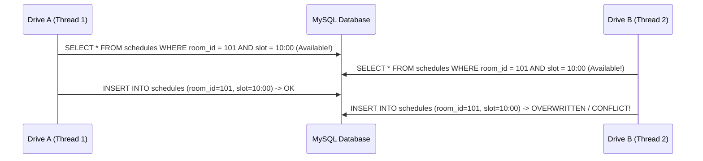

# OSPP Concurrency & Resource Allocation Model
## Engine 1: Operating Systems Principles and Practices
**Document:** Theoretical Framework, Deadlock Avoidance, and Synchronization Engine  
**Project:** Placement Drive and Candidate Approval Management System

---

## 1. Operating Systems Mapping & Formal Analogy

The recruitment scheduling process mirrors classical multi-programmed operating system resource management. Each entity in the placement workflow maps to an OS concept:

| OS Concept | Placement System Counterpart | Description |
| :--- | :--- | :--- |
| **Process / Thread** | `Placement Drive Session Request` | An execution unit requesting resources to conduct an interview or test. |
| **Hardware Resource 1** | `Interview Room / Lab` | Mutually exclusive spatial resource ($R$). Capacity = 1 candidate or batch. |
| **Hardware Resource 2** | `Interviewer / Panelist` | Non-sharable human evaluation resource ($I$). |
| **Hardware Resource 3** | `Candidate / Student` | The subject of evaluation ($S$). Cannot be partitioned across multiple panels. |
| **Time Slice / Quantum** | `Interview Time Window` | Discrete interval $[T_{start}, T_{end}]$ allocated for execution. |
| **Critical Section** | `Booking State Mutation` | The atomic block where database status is checked and updated. |
| **Deadlock** | `Circular Resource Deadlock` | Drive 1 holds Room A, waiting for Panelist X; Drive 2 holds Panelist X, waiting for Room A. |

---

## 2. Deadlock Prevention: Mathematical Proof via Havender's Total Ordering

### The Four Coffman Conditions in Placement Scheduling
A deadlock can arise if and only if all four Coffman conditions hold simultaneously:
1. **Mutual Exclusion:** A room or interviewer cannot be shared concurrently by two independent interview sessions.
2. **Hold and Wait:** A drive session acquires a room and holds it while awaiting interviewer confirmation.
3. **No Preemption:** A scheduled room or panelist cannot be forcibly revoked once granted without aborting the session.
4. **Circular Wait:** There exists a closed chain of requests $\{P_0, P_1, \dots, P_k\}$ such that $P_0$ is waiting for a resource held by $P_1$, and $P_k$ is waiting for a resource held by $P_0$.

### Elimination of Circular Wait (Havender's Principle)
To prevent deadlocks without the high overhead of periodic runtime detection, we enforce a **Global Strict Resource Ordering Function** $f$:

Let the universe of resources be partitioned into three disjoint classes:
$$\mathcal{U} = \mathcal{R}_{rooms} \cup \mathcal{I}_{interviewers} \cup \mathcal{S}_{students}$$

We define an injective ranking function $f: \mathcal{U} \to \mathbb{N}$ such that:
$$\forall r \in \mathcal{R}_{rooms}, \forall i \in \mathcal{I}_{interviewers}, \forall s \in \mathcal{S}_{students}: \quad f(r) < f(i) < f(s)$$

Specifically:
- $f(r) = 1 \times 10^9 + \text{room\_id}$
- $f(i) = 2 \times 10^9 + \text{interviewer\_id}$
- $f(s) = 3 \times 10^9 + \text{student\_id}$

#### Rule of Resource Acquisition:
> Any scheduling request $P$ requiring a multi-resource bundle $\{X_1, X_2, \dots, X_m\}$ must request and acquire locks in strictly increasing order of their ranking:
> $$f(X_{(1)}) < f(X_{(2)}) < \dots < f(X_{(m)})$$

#### Mathematical Proof of Deadlock Impossibility:
Assume for contradiction that a deadlock exists. By definition, there must exist a cycle in the Resource Allocation Graph (RAG):
$$P_1 \to R_1 \to P_2 \to R_2 \to \dots \to P_k \to R_k \to P_1$$

Where each process $P_j$ holds resource $R_{j-1}$ and requests $R_j$.  
Under our acquisition rule, a process can only request $R_j$ if $f(R_j) > f(R_{j-1})$.  
Traversing the complete cycle yields:
$$f(R_1) < f(R_2) < \dots < f(R_k) < f(R_1)$$
$$\implies f(R_1) < f(R_1)$$

This is a strict mathematical contradiction. Therefore, **no cycle can ever form**, and the system is provably immune to deadlock.

---

## 3. Concurrency Control & Race Condition Elimination

### The Double-Booking Race Condition Anomaly
In an asynchronous environment (such as Express.js handling multiple concurrent HTTP threads), two independent requests arriving at $t_0$ might both observe Room 101 as available:



### Architectural Solution: Dual-Tier Concurrency Control

#### Tier 1: In-Memory Keyed Mutex Lock (Node.js Service Layer)
Before initiating database queries, the OSPP engine hashes the resource tuple and checks an internal mutex table. If locked, subsequent requests enter an asynchronous await queue:

```javascript
// Pseudocode for In-Memory Keyed Mutex
class KeyedMutex {
    constructor() {
        this.locks = new Map();
    }

    async acquire(resourceKeys) {
        // Enforce strict ascending order
        const sortedKeys = [...resourceKeys].sort();
        for (const key of sortedKeys) {
            while (this.locks.has(key)) {
                await this.locks.get(key); // Await release promise
            }
            let resolver;
            const promise = new Promise(resolve => { resolver = resolve; });
            promise.resolve = resolver;
            this.locks.set(key, promise);
        }
    }

    release(resourceKeys) {
        for (const key of resourceKeys) {
            if (this.locks.has(key)) {
                const promise = this.locks.get(key);
                this.locks.delete(key);
                promise.resolve();
            }
        }
    }
}
```

#### Tier 2: Database Pessimistic Row Locking (`SELECT ... FOR UPDATE`)
All scheduling transactions execute under `REPEATABLE READ` isolation:
```sql
START TRANSACTION;

-- Lock conflicting records in ascending ID order
SELECT id FROM rooms WHERE id = ? FOR UPDATE;
SELECT id FROM interviewers WHERE id = ? FOR UPDATE;

-- Evaluate Interval Overlap Condition
SELECT COUNT(*) FROM interview_schedules 
WHERE room_id = ? 
  AND status = 'scheduled'
  AND (start_time < ? AND end_time > ?)
FOR UPDATE;

-- If count == 0:
INSERT INTO interview_schedules ...;
COMMIT;
-- Else:
ROLLBACK;
```

---

## 4. Banker's Algorithm for Bulk Placement Allocations

When a major recruiter conducts a campus drive requiring bulk resource reservations (e.g., reserving 10 rooms and 8 panelists simultaneously), the OSPP engine runs Dijkstra's Banker's Algorithm to guarantee that the system remains in a **Safe State**:

### State Matrix Definitions
- **Available Vector $\mathbf{A}[m]$:** Number of free units for each resource class (Rooms, Panelists, Invigilators).
- **Max Matrix $\mathbf{M}[n \times m]$:** Maximum resource demand declared by each drive $D_i$.
- **Allocation Matrix $\mathbf{C}[n \times m]$:** Currently allocated resources to each drive $D_i$.
- **Need Matrix $\mathbf{N}[n \times m]$:** Remaining resource requirement: $\mathbf{N}[i, j] = \mathbf{M}[i, j] - \mathbf{C}[i, j]$.

### Safety Algorithm Evaluation:
1. Let $\mathbf{Work} = \mathbf{A}$ and $\mathbf{Finish}[i] = \text{false}$ for $i = 1, \dots, n$.
2. Find an index $i$ such that:
   $$\mathbf{Finish}[i] == \text{false} \land \mathbf{Need}[i] \le \mathbf{Work}$$
   If no such $i$ exists, go to step 4.
3. $\mathbf{Work} = \mathbf{Work} + \mathbf{Allocation}[i]$; $\mathbf{Finish}[i] = \text{true}$; return to step 2.
4. If $\mathbf{Finish}[i] == \text{true} \ \forall i$, then the system is in a **Safe State**; otherwise, it is **Unsafe**.

If a batch booking request causes an Unsafe state, the allocation is deferred or partitioned into smaller rounds.

---

## 5. CPU Scheduling Analogues in Student Lifecycle

### 1. FCFS (First-Come, First-Served) Engine
- **Applied to:** Student document verification, initial profile approvals, registration submissions.
- **Data Structure:** FIFO Queue ($O(1)$ enqueue, $O(1)$ dequeue).
- **Metric:** Turnaround time $\tau = T_{\text{completion}} - T_{\text{submission}}$.

### 2. Priority Scheduling Engine
- **Applied to:** Interview slot assignment and company shortlisting queues.
- **Priority Calculation:**
  $$P(\text{student}) = (\text{CGPA} \times 10) + (\text{OnlineTestScore} \times 0.6) + \text{TierBonus}$$
- **Mode:**
  - *Non-preemptive:* Once an interview is scheduled and confirmed, it runs to completion without interruption.
  - *Preemptive Queue Re-ordering:* If a higher-tier recruiter shortlists a student before final scheduling, slot dispatcher dynamically elevates student position in the allocation queue.

---

## 6. Producer-Consumer Bounded Buffer Notification Queue

The notification subsystem decouples database transactional events from time-consuming alert dispatches using a classic Producer-Consumer architecture with counting semaphores:

```mermaid
graph LR
    subgraph Producers ["Producers (Events)"]
        P1["Drive Created"]
        P2["HR Shortlisted"]
        P3["Slot Scheduled"]
    end

    subgraph BoundedBuffer ["Bounded Circular Buffer Queue (Size = K)"]
        Slot0["[0] Item"]
        Slot1["[1] Item"]
        Slot2["[2] Empty"]
        Slot3["[...] Empty"]
        SlotK["[K-1] Empty"]
    end

    subgraph Semaphores ["Synchronization Primitives"]
        Mutex["Binary Mutex: 1"]
        Empty["Counting Semaphore 'empty': K"]
        Full["Counting Semaphore 'full': 0"]
    end

    subgraph Consumers ["Consumer Pool"]
        C1["Notification Worker 1"]
        C2["Notification Worker 2"]
    end

    Producers -->|wait(empty) + wait(mutex)| BoundedBuffer
    BoundedBuffer -->|wait(full) + wait(mutex)| Consumers
```

- **Producer Routine:**
  1. `wait(empty_slots)`
  2. `wait(buffer_mutex)`
  3. `buffer.append(notification_payload)`
  4. `signal(buffer_mutex)`
  5. `signal(full_slots)`
- **Consumer Routine:**
  1. `wait(full_slots)`
  2. `wait(buffer_mutex)`
  3. `item = buffer.dequeue()`
  4. `signal(buffer_mutex)`
  5. `signal(empty_slots)`
  6. `dispatch_notification(item)`
